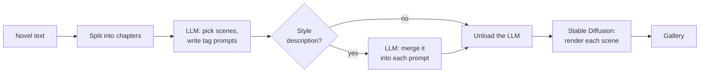

# novel2img

English | [简体中文](README.zh-CN.md)

[](https://github.com/RalfZhang/novel2img/actions/workflows/ci.yml)

[](LICENSE)

Turn a novel into an illustrated storyboard, entirely on your own machine.

A local LLM reads a chapter, picks its most visual moments and writes an image prompt for each one.
Stable Diffusion then renders the scenes, and each image streams into the browser as soon as it is
done.

**Stack:** Python · FastAPI · asyncio · Server-Sent Events · Ollama · 🤗 diffusers / PyTorch
(CUDA, Apple MPS, CPU) · vanilla JavaScript · pytest · GitHub Actions

## How it works



- **Whole books in, one chapter at a time out.** Chapter headings (`第一章`, `Chapter 1`,
  `CHAPTER IV`, `Prologue` …) are detected automatically.
- **Style changes in plain words, in any language**, such as "watercolor; make the hero a
  silver-haired girl". The LLM works them into every prompt.
- **Any SD 1.5 or SDXL checkpoint**, with optional LoRAs, plus an English/Chinese web UI and an
  HTTP API.

## Engineering highlights

- **Two-stage LLM pipeline.** One call plans the scenes in JSON mode. Then the style description
  is merged into each scene's prompt in parallel (`asyncio.gather`). If one call fails, that scene
  keeps its original prompt.
- **Reliable output from small local models.** 8B models often break the format. Replies are
  parsed leniently (code fences, extra text, several JSON shapes). A tag sanitizer splits
  sentence-like tags such as `her_hair_is_long_and_silver` into real tags.
- **CLIP-aware prompt trimming.** CLIP reads only 77 tokens and cuts in the middle of a tag.
  Prompts are trimmed tag by tag against both SDXL tokenizers, so the least important tags go first.
- **Fits on a 16 GB laptop.** The LLM is unloaded from Ollama before SDXL loads. The context size
  stays fixed, so Ollama never reloads the model during a run. The checkpoint loads lazily, once,
  behind a lock.
- **Streaming and fault-tolerant.** The pipeline is an async generator of typed events, sent to
  the browser as Server-Sent Events. A failed image is reported and skipped; the rest of the
  chapter still renders.
- **Cross-platform inference.** Picks CUDA, Apple MPS or CPU automatically. The Euler a sampler is
  used because other samplers give NaN (black) images with MPS and fp16.
- **Testable without a GPU.** Ollama and the image model are injected dependencies, so the tests
  use fakes and finish in about a second. CI runs ruff and pytest on Python 3.9 and 3.12.

## Quick start

You need Python 3.9+, [Ollama](https://ollama.com), and an SDXL anime checkpoint as a single
`.safetensors` file (for example WAI-Illustrious-SDXL). SDXL needs about 8 GB of VRAM, or 16 GB of
unified memory on Apple Silicon.

```bash
ollama pull BlackHillsInfoSec/llama-3.1-8b-abliterated
git clone https://github.com/RalfZhang/novel2img.git
cd novel2img
cp ~/Downloads/waiIllustriousSDXL_v170.safetensors models/
./run.sh    # creates .venv, installs dependencies, creates .env
```

Open <http://127.0.0.1:8000> and paste a chapter, or try a sample story from
[`examples/novels/`](examples/novels/).

For Windows, configuration, the HTTP API, prompt templates and troubleshooting, see the
[developer guide](docs/dev.md).

## Project layout

```text
novel2img/
├── chapters.py     split a novel into chapters
├── llm.py          Ollama client and lenient JSON parsing
├── scenes.py       pick scenes and merge style descriptions (LLM)
├── tags.py         clean up Danbooru tag prompts
├── image_gen.py    diffusers: model loading, LoRAs, CLIP-aware prompt trimming
├── pipeline.py     chapter → scenes → images, as a stream of events
├── server.py       FastAPI app: HTTP API and web UI
├── prompts/        LLM prompt templates
└── static/         web UI (plain HTML, CSS and JavaScript, no build step)
```

## License

[MIT](LICENSE). The models you download come with their own licenses. novel2img doesn't filter
text or images; see [responsible use](docs/dev.md#responsible-use).
