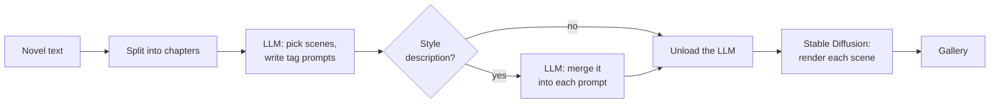

# novel2img

English | [简体中文](README.zh-CN.md)

Turn novel chapters into illustrated storyboards, entirely on your own machine.

Paste a chapter, or a whole book. novel2img asks a local LLM to pick the most visual moments and
write a Danbooru-style tag prompt for each one, then renders every scene with a Stable Diffusion
checkpoint. The images appear in the gallery one by one as they finish.

## Features

- **Whole books in, one chapter at a time out.** Chapter headings are detected automatically
  (`第一章 …`, `Chapter 1`, `CHAPTER IV`, `Prologue` …). Generate a chapter, then click *Next chapter*.
- **Scene planning with any Ollama model.** The LLM picks up to N key moments per chapter and
  writes a prompt of about 30–45 tags for each, most important first.
- **Style changes in plain words.** Type "watercolor; make the hero a silver-haired girl", in any
  language, and the LLM works it into every prompt next to the tags it belongs with, instead of
  appending it at the end.
- **Prompts that fit.** Sentences squashed into tags are split up, and prompts are trimmed tag by
  tag to CLIP's 77-token window, dropping the least important tags first.
- **Any single-file SD 1.5 or SDXL checkpoint**, plus optional LoRAs with individual weights.
- **Local.** Runs on Apple Silicon (MPS), NVIDIA GPUs (CUDA) or the CPU. Your text and images
  never leave your machine.
- **English and Chinese UI**, plus an HTTP API with Server-Sent Events for scripting.

## How it works



1. The text is split into chapters at their headings (plain pattern matching, no LLM).
2. The LLM, served by [Ollama](https://ollama.com), reads one chapter and returns up to
   `MAX_SCENES` scenes as JSON: a one-line summary in the novel's language and an English
   Danbooru tag prompt.
3. If you entered a style description, the LLM merges it into each prompt (one call per scene,
   in parallel).
4. The LLM is unloaded to free memory, then the checkpoint renders the scenes with
   [🤗 diffusers](https://github.com/huggingface/diffusers). Each image is sent to the browser as
   soon as it is done.

The built-in prompts are written for anime-style SDXL checkpoints that understand Danbooru tags
(Illustrious, NoobAI and their many derivatives). For other models, adapt the
[prompt templates](#customizing-the-prompts).

## Requirements

- Python 3.9 or newer
- [Ollama](https://ollama.com) and a chat model
- A Stable Diffusion checkpoint as a single `.safetensors` file. SDXL anime checkpoints that
  understand Danbooru tags work best, for example WAI-Illustrious-SDXL or another Illustrious-XL
  derivative.
- For SDXL, roughly 8 GB of VRAM, or 16 GB of unified memory on Apple Silicon (the LLM is
  unloaded before rendering so that both fit).

## Quick start

1. Install Ollama, make sure it is running, and pull a model:

   ```bash
   ollama pull BlackHillsInfoSec/llama-3.1-8b-abliterated
   ```

2. Clone this repository and put your checkpoint in `models/`:

   ```bash
   git clone https://github.com/RalfZhang/novel2img.git
   cd novel2img
   cp ~/Downloads/waiIllustriousSDXL_v170.safetensors models/
   ```

   Another file name is fine too; point `SD_MODEL_PATH` in `.env` at it.

3. Start it (macOS and Linux):

   ```bash
   ./run.sh
   ```

   The first run creates a virtual environment in `.venv`, installs the dependencies (including
   PyTorch, so it takes a while) and copies `.env.example` to `.env`.

4. Open <http://127.0.0.1:8000>.

The first generation also loads the checkpoint, which takes 30–60 seconds, and downloads a few
small configuration files (not weights) from Hugging Face.

<details>
<summary>Windows, or installing by hand</summary>

```shell
python -m venv .venv
.venv\Scripts\activate          # macOS / Linux: source .venv/bin/activate
pip install -e .
copy .env.example .env          # macOS / Linux: cp .env.example .env
novel2img                       # or: python -m novel2img
```

On Windows, `pip install torch` installs a CPU-only build. For an NVIDIA GPU, install a CUDA build
of PyTorch first, using the selector on <https://pytorch.org/get-started/locally/>, then run
`pip install -e .`.

`novel2img --host 0.0.0.0 --port 8000` makes the UI reachable from other devices on your network.
</details>

## Using the web UI

1. Paste a chapter, or a whole novel, into the large text box. Chapters are detected as you type;
   pick one from the list.
2. Optionally describe the style or changes you want, for example:
   - `watercolor, soft lighting`
   - `make the hero a silver-haired girl in light armor`
   - `水墨画风，冷色调` (any language works)
3. Click **Generate chapter**. The scene cards appear first, then each image as it finishes.
   Click an image to open it at full size; **Show prompt** shows the exact prompt the model received.
4. Click **Next chapter →** to continue with the following chapter.

Leave **Seed** empty for random images. With a seed, scene *i* uses seed + *i*, so you can render
a chapter again exactly. Images are saved in `outputs/`.

## Examples

`examples/novels/` contains two short original stories to try:

| File | Story |
| --- | --- |
| [`lantern-keeper.en.txt`](examples/novels/lantern-keeper.en.txt) | English, 3 chapters: a lighthouse keeper, a shipwreck and a strange lantern |
| [`snow-night.zh.txt`](examples/novels/snow-night.zh.txt) | Chinese wuxia, 3 chapters: a swordsman returns to his sect on a snowy night |

There are also two scripts. Run them from the repository root, with the virtual environment
activated (`source .venv/bin/activate`).

**Plan scenes without rendering anything.** This only needs Ollama, no GPU, which makes it handy
for checking chapter detection and for tuning prompts:

```bash
python examples/plan_scenes.py examples/novels/lantern-keeper.en.txt --chapter 2
python examples/plan_scenes.py examples/novels/snow-night.zh.txt --style "watercolor; make the hero a woman"
```

**Generate a chapter through the HTTP API** and save the images (the server must be running):

```bash
python examples/api_client.py examples/novels/snow-night.zh.txt --chapter 3 --seed 42 --out storyboard/
```

Or with `curl`:

```bash
curl -N http://127.0.0.1:8000/api/generate \
  -H 'Content-Type: application/json' \
  -d '{"text": "Chapter 1\nThe storm broke over the lighthouse.", "max_scenes": 2}'
```

## Configuration

Settings are read from `.env`, which `run.sh` creates from [`.env.example`](.env.example).
Environment variables override the file. Relative paths are resolved against the directory you
start novel2img from.

| Variable | Default | Description |
| --- | --- | --- |
| `OLLAMA_URL` | `http://127.0.0.1:11434` | Ollama server |
| `OLLAMA_MODEL` | `BlackHillsInfoSec/llama-3.1-8b-abliterated` | Chat model that plans the scenes and writes the prompts |
| `OLLAMA_NUM_CTX` | `8192` | LLM context window in tokens; raise it for very long chapters |
| `OLLAMA_UNLOAD` | `true` | Unload the LLM before rendering, to free memory for the image model |
| `SD_MODEL_PATH` | `models/waiIllustriousSDXL_v170.safetensors` | Checkpoint file |
| `SD_IS_SDXL` | `true` | `true` for SDXL-based checkpoints (Illustrious, NoobAI, Pony …), `false` for SD 1.5 |
| `SD_DEVICE` | `auto` | `auto`, `cuda`, `mps` or `cpu` |
| `SD_DTYPE` | `float16` | `float16`, `bfloat16` or `float32` (the CPU always uses `float32`) |
| `LORA_DIR` | `models/lora` | Folder with LoRA files |
| `LORA_SPEC` | *(empty)* | LoRAs to load, as `file.safetensors:weight,…`; the weight defaults to 1.0, and slider LoRAs accept negative weights |
| `IMG_WIDTH`, `IMG_HEIGHT` | `832`, `1216` | Image size; SDXL works best at about one megapixel |
| `IMG_STEPS` | `24` | Sampling steps |
| `IMG_CFG` | `5.5` | Guidance scale (CFG) |
| `MAX_SCENES` | `8` | Default maximum number of scenes per chapter; the UI can change it |
| `QUALITY_TAGS` | `masterpiece, best quality, …` | Tags put in front of every prompt |
| `NEGATIVE_PROMPT` | `bad quality, worst quality, …` | Negative prompt |
| `OUTPUT_DIR` | `outputs` | Where images are saved |
| `PROMPTS_DIR` | *(empty)* | Folder with your own prompt templates, see below |
| `LOG_LEVEL` | `INFO` | Server log level |

**Which LLM?** The default is an "abliterated" Llama 3.1 8B, which doesn't refuse the dark or
violent scenes that fiction is full of. Any Ollama chat model works; models that follow JSON
instructions reliably give the best results. For Chinese novels, a Qwen model such as
`qwen2.5:7b` understands the text better.

## Customizing the prompts

The instructions sent to the LLM are Markdown templates in
[`novel2img/prompts/`](novel2img/prompts/):

| Template | Purpose | Placeholders |
| --- | --- | --- |
| `scene_system.md` | Rules and examples for picking scenes and writing tags | `$max_scenes` |
| `scene_user.md` | Wraps the chapter | `$title`, `$body`, `$max_scenes` |
| `adjust_system.md` | Rules for merging a style description into a prompt | none |
| `adjust_user.md` | Wraps one prompt and the description | `$input` (JSON with both), `$prompt`, `$adjustment` |

To change them without editing the package, copy the templates you want into a folder of your
own, edit them there, and set `PROMPTS_DIR` to that folder. Templates missing from it fall back to
the built-in ones. Templates are read again on every request, so you can iterate with
`examples/plan_scenes.py` without restarting anything. Typical reasons are examples that suit
your checkpoint or genre better, or summaries in a fixed language.

## HTTP API

| Endpoint | Description |
| --- | --- |
| `GET /api/config` | Model names and defaults, used by the UI |
| `POST /api/split` | `{"text"}` → `{"chapters": [{"index", "title", "length"}]}` |
| `POST /api/generate` | Generates one chapter and streams the progress as Server-Sent Events |

`/api/generate` takes `{"text", "chapter_index": 0, "style": "", "max_scenes": null, "seed": null}`.
`text` may be the whole novel; `chapter_index` picks the chapter. It streams these events:

| Event | Data |
| --- | --- |
| `chapter` | `index`, `title`, `total`, `has_next` |
| `status` | `stage` (`planning`, `adjusting`, `unloading_llm`, `loading_model`, `rendering`) and `message`; while rendering also `scene_index` and `total` |
| `scenes` | `count` and `scenes`: `[{summary, prompt, original_prompt?}]` |
| `image` | `scene_index`, `summary`, `prompt`, `full_prompt`, `seed`, `filename`, `url` |
| `error` | `message`. With `scene_index`, only that image failed and the others continue; without it, the run has stopped |
| `done` | `chapter_index` |

FastAPI's interactive API docs are at <http://127.0.0.1:8000/docs>.

## Project layout

```text
novel2img/
├── chapters.py     split a novel into chapters
├── llm.py          Ollama client and lenient JSON parsing
├── scenes.py       pick scenes and merge style descriptions (LLM)
├── tags.py         clean up Danbooru tag prompts
├── image_gen.py    diffusers: model loading, LoRAs, CLIP-aware prompt trimming
├── pipeline.py     chapter → scenes → images, as a stream of events
├── server.py       FastAPI app: HTTP API and web UI
├── config.py       settings from .env and environment variables
├── cli.py          the novel2img command
├── prompts/        LLM prompt templates
└── static/         web UI (plain HTML, CSS and JavaScript, no build step)
examples/           sample novels and example scripts
tests/              tests (no GPU, Ollama or model needed)
```

## Development

```bash
pip install -e ".[dev]"
pytest
ruff check .
```

The tests replace Ollama and the image model with fakes, so they finish in about a second on any
machine. `novel2img --reload` restarts the server whenever the code changes.

## Troubleshooting

- **"Cannot reach Ollama"**: start Ollama (the app, or `ollama serve`) and check `OLLAMA_URL`.
- **"model … not found"**: pull the model first, `ollama pull <OLLAMA_MODEL>`.
- **"Image model not found"**: put the checkpoint where `SD_MODEL_PATH` points.
- **The first image takes long**: loading the checkpoint takes 30–60 seconds, once per server start.
- **Out of memory, or very slow, on a 16 GB machine**: keep `OLLAMA_UNLOAD=true`, close other large
  apps, and lower `IMG_WIDTH` / `IMG_HEIGHT`. On a 16 GB Apple Silicon Mac, expect about 30–60
  seconds per image at 24 steps.
- **huggingface.co is unreachable**: the first model load fetches small configuration files from
  Hugging Face. Set a mirror in `.env`, for example `HF_ENDPOINT=https://hf-mirror.com`. Once the
  files are cached, `HF_HUB_OFFLINE=1` avoids the network entirely.
- **Prompts read like sentences, or have few tags**: small models vary a lot. Try another
  `OLLAMA_MODEL`, or adjust the [prompt templates](#customizing-the-prompts).
- **Chapters are not detected**: each heading must be on a line of its own, such as `第一章 标题`,
  `第12回`, `Chapter 3: Title`, `CHAPTER IV` or `Prologue`. Text before the first heading (title
  page, author) is skipped; text without any heading is treated as one chapter.

## Responsible use

novel2img doesn't filter text or images: what it produces depends on your text, your models and
your settings. Respect the licenses of the models you use and the laws where you live. Don't use it
to depict real people without their consent, or to create sexual content involving minors.

## License

[MIT](LICENSE). The models you download come with their own licenses.
