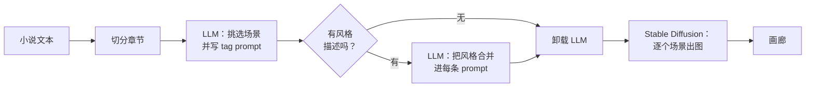

# novel2img

[English](README.md) | 简体中文

[](https://github.com/RalfZhang/novel2img/actions/workflows/ci.yml)

[](LICENSE)

把小说变成插画分镜，全部在你自己的电脑上完成。

本地大语言模型（LLM）读取一章内容，挑出最有画面感的情节，为每个情节写一条图像 prompt；再由
Stable Diffusion 逐一出图，每生成一张就立刻推送到浏览器。

**技术栈：** Python · FastAPI · asyncio · Server-Sent Events · Ollama · 🤗 diffusers / PyTorch
（CUDA、Apple MPS、CPU）· 原生 JavaScript · pytest · GitHub Actions

## 工作原理



- **整本粘贴，逐章生成**：自动识别章节标题（`第一章`、`Chapter 1`、`CHAPTER IV`、`楔子` 等）。
- **用自然语言调整风格，中英文均可**：例如「水彩画风；把主角改成银发少女」，LLM 会把要求融入每条 prompt。
- **支持任意 SD 1.5 / SDXL 模型**，可叠加 LoRA；提供中英文网页界面和 HTTP API。

## 技术亮点

- **两阶段 LLM 流水线**：第一次调用以 JSON 模式规划场景；之后用 `asyncio.gather` 把风格描述并行合并进
  每个场景的 prompt。某次调用失败时，该场景保留原 prompt。
- **让本地小模型稳定输出**：8B 级别的模型经常不按格式输出。回复解析很宽松（兼容代码块、多余文字、多种
  JSON 结构）；tag 清洗器会把 `her_hair_is_long_and_silver` 这类「句子式 tag」拆成真正的 tag。
- **按 CLIP 长度截断 prompt**：CLIP 只读 77 个 token，并且会在 tag 中间截断。这里用 SDXL 的两个
  tokenizer 逐个 tag 截断，优先丢弃最不重要的 tag。
- **16 GB 笔记本也能跑**：加载 SDXL 前先从 Ollama 卸载 LLM；上下文长度保持不变，避免 Ollama 在运行中
  重新加载模型；图像模型按需加载，只加载一次，并用锁保护。
- **流式输出，局部容错**：流水线是一个输出类型化事件的异步生成器，通过 Server-Sent Events 推送到浏览器。
  某张图失败只会报告并跳过，本章其余场景继续生成。
- **跨平台推理**：自动选择 CUDA、Apple MPS 或 CPU。选用 Euler a 采样器，是因为其他采样器在 MPS + fp16
  下会产生 NaN（全黑）图片。
- **无需显卡即可测试**：Ollama 和图像模型通过依赖注入传入，测试使用替身实现，大约一秒跑完。CI 在
  Python 3.9 和 3.12 上运行 ruff 和 pytest。

## 快速开始

需要 Python 3.9+、[Ollama](https://ollama.com)，以及一个单文件 `.safetensors` 格式的 SDXL 二次元模型
（例如 WAI-Illustrious-SDXL）。SDXL 大约需要 8 GB 显存；Apple Silicon 需要 16 GB 统一内存。

```bash
ollama pull BlackHillsInfoSec/llama-3.1-8b-abliterated
git clone https://github.com/RalfZhang/novel2img.git
cd novel2img
cp ~/Downloads/waiIllustriousSDXL_v170.safetensors models/
./run.sh    # 创建 .venv、安装依赖、生成 .env
```

打开 <http://127.0.0.1:8000>，粘贴一章小说，或者试试 [`examples/novels/`](examples/novels/) 里的示例故事。

Windows 安装、配置项、HTTP API、prompt 模板和常见问题，请看[开发文档](docs/dev.zh-CN.md)。

## 项目结构

```text
novel2img/
├── chapters.py     章节切分
├── llm.py          Ollama 客户端，宽松的 JSON 解析
├── scenes.py       挑选场景、合并风格描述（LLM）
├── tags.py         清洗 Danbooru tag prompt
├── image_gen.py    diffusers：模型加载、LoRA、按 CLIP 长度截断 prompt
├── pipeline.py     章节 → 场景 → 图片，以事件流输出进度
├── server.py       FastAPI 应用：HTTP API 与网页界面
├── prompts/        LLM prompt 模板
└── static/         网页界面（纯 HTML、CSS、JavaScript，无需构建）
```

## 许可证

[MIT](LICENSE)。你下载的模型有各自的许可协议。novel2img 不会过滤文本或图片，请阅读
[合理使用](docs/dev.zh-CN.md#合理使用)。
